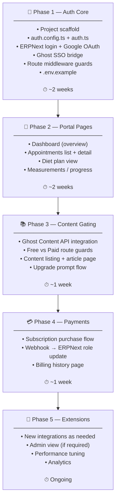

# Nutrishift Patient Portal — New Standalone App
## Greenfield Architecture & Boilerplate Plan

> [!IMPORTANT]
> **This is a completely new, independent project.**
> - New Git repository — separate from `Ghost-My-CMS-Portal`
> - New folder — e.g. `C:\wamp64\www\nutrishift-portal` or wherever you keep projects
> - Zero dependency on the Ghost theme codebase
> - No code copied from the old repo — patterns are re-implemented cleanly in TypeScript

---

## Stack — Latest Stable (October 2026)

| Layer | Technology | Version / Notes |
|---|---|---|
| Framework | **Next.js 16** | App Router, Turbopack default, PPR, `use cache` |
| Language | **TypeScript 5.x** | Strict mode |
| Auth | **Auth.js v5** (NextAuth) | `next-auth@beta`, JWT strategy, no DB adapter needed |
| Styling | **Tailwind CSS 4** | Zero-config, CSS-first |
| UI Components | **shadcn/ui** | Copy-paste components, fully owned, no lock-in |
| Forms | **React Hook Form + Zod** | Validation on client AND server |
| HTTP Client | **native `fetch()`** | Next.js 16 fetch is extended — no axios needed |
| Deployment | **Vercel** | Preview deploys, Edge Middleware, env management |
| Error Monitoring | **Sentry** | Know about ERPNext/Ghost failures before users do |
| Package Manager | **pnpm** | Faster, better monorepo-ready if needed later |

> [!NOTE]
> **Why Next.js 16?** Turbopack is now the default bundler (10x faster builds). The `use cache` directive replaces the old `fetch` cache options — cleaner and more predictable. React Compiler is stable, giving automatic memoization. All of this matters for a portal with real clinical data fetching.

---

## 1. Project Initialization

```bash
# Run this — creates a fresh Next.js 16 project
pnpm create next-app@latest nutrishift-portal \
  --typescript \
  --tailwind \
  --app \
  --src-dir \
  --import-alias "@/*" \
  --turbopack

cd nutrishift-portal

# Auth.js v5
pnpm add next-auth@beta

# Forms & validation
pnpm add react-hook-form zod @hookform/resolvers

# UI components (shadcn init)
pnpm dlx shadcn@latest init

# Utilities
pnpm add server-only jose clsx tailwind-merge

# Error monitoring
pnpm add @sentry/nextjs

# Dev tools
pnpm add -D @types/node prettier eslint-config-prettier
```

> [!TIP]
> `server-only` is a zero-byte package. Importing it in any file causes a **build error** if that file is ever accidentally imported in a Client Component. Use it in every file under `lib/`. This is your hard security boundary.

---

## 2. Folder Structure

```
nutrishift-portal/
├── src/
│   ├── app/                          # Next.js App Router
│   │   │
│   │   ├── (public)/                 # Unauthenticated pages
│   │   │   ├── login/
│   │   │   │   └── page.tsx
│   │   │   ├── register/
│   │   │   │   └── page.tsx
│   │   │   └── layout.tsx
│   │   │
│   │   ├── (portal)/                 # Authenticated pages — guarded by middleware
│   │   │   ├── layout.tsx            # Sidebar + header layout
│   │   │   ├── dashboard/
│   │   │   │   └── page.tsx
│   │   │   ├── appointments/
│   │   │   │   ├── page.tsx
│   │   │   │   └── [id]/page.tsx
│   │   │   ├── diet-plan/
│   │   │   │   └── page.tsx
│   │   │   ├── measurements/
│   │   │   │   └── page.tsx
│   │   │   ├── content/              # Ghost CMS gated content (paid only)
│   │   │   │   ├── page.tsx
│   │   │   │   └── [slug]/page.tsx
│   │   │   └── settings/
│   │   │       └── page.tsx
│   │   │
│   │   ├── api/
│   │   │   ├── auth/
│   │   │   │   └── [...nextauth]/
│   │   │   │       └── route.ts      # Auth.js handler
│   │   │   └── webhooks/
│   │   │       ├── payment/
│   │   │       │   └── route.ts      # Stripe / payment webhook
│   │   │       └── ghost/
│   │   │           └── route.ts      # Ghost event webhook
│   │   │
│   │   ├── layout.tsx                # Root layout (fonts, providers)
│   │   └── not-found.tsx
│   │
│   ├── lib/                          # SERVER-ONLY integration clients
│   │   │                             # Every file starts with: import 'server-only'
│   │   ├── erpnext/
│   │   │   ├── client.ts             # Fetch wrapper with per-user auth headers
│   │   │   ├── patient.ts            # Patient doctype — get, update profile
│   │   │   ├── appointments.ts       # Appointment queries
│   │   │   ├── diet.ts               # Diet plan queries
│   │   │   ├── measurements.ts       # Body metrics queries
│   │   │   └── types.ts              # ERPNext response types (Zod schemas)
│   │   │
│   │   ├── ghost/
│   │   │   ├── admin.ts              # Ghost Admin API — provision member, set labels
│   │   │   ├── content.ts            # Ghost Content API — fetch posts, pages by tag/tier
│   │   │   ├── sso.ts                # Ghost SSO JWT builder (auto-login bridge)
│   │   │   └── types.ts
│   │   │
│   │   ├── payments/                 # Pluggable — add any provider here
│   │   │   ├── index.ts              # Exports unified interface
│   │   │   ├── stripe.ts             # Stripe client (if using Stripe)
│   │   │   └── types.ts
│   │   │
│   │   └── auth/
│   │       ├── session.ts            # Helper: getRequiredSession() throws if no auth
│   │       └── types.ts              # NutriSession type definition
│   │
│   ├── auth.config.ts                # Auth.js — Edge-safe config (providers, pages, callbacks)
│   ├── auth.ts                       # Auth.js — full config (exports: auth, handlers, signIn, signOut)
│   │
│   ├── middleware.ts                 # Route protection — Edge runtime
│   │
│   ├── components/
│   │   ├── ui/                       # shadcn/ui base components (Button, Card, Input…)
│   │   ├── portal/                   # Domain-specific components
│   │   │   ├── AppointmentCard.tsx
│   │   │   ├── DietPlanSection.tsx
│   │   │   ├── MeasurementChart.tsx
│   │   │   └── ContentCard.tsx
│   │   └── layout/
│   │       ├── Sidebar.tsx
│   │       ├── Header.tsx
│   │       └── RoleGate.tsx          # Client component: shows/hides based on role
│   │
│   ├── actions/                      # Next.js Server Actions
│   │   ├── auth.ts                   # login, logout, register actions
│   │   └── portal.ts                 # update profile, book appointment actions
│   │
│   └── types/
│       └── index.ts                  # Shared app-wide types
│
├── auth.config.ts                    # (root level — required by middleware)
├── auth.ts                           # (root level — required by middleware)
├── middleware.ts                     # (root level — required by Next.js)
├── next.config.ts
├── tailwind.config.ts
├── tsconfig.json
├── .env.local                        # Never committed
├── .env.example                      # Committed — shows required keys, no values
├── .gitignore
└── package.json
```

---

## 3. Auth Split — Edge-Safe Pattern (Next.js 16 Requirement)

Next.js Middleware runs on the **Edge runtime**. Auth.js with custom providers must be split into two files:

### `auth.config.ts` — Edge-safe (no Node.js APIs)
```typescript
import type { NextAuthConfig } from 'next-auth'
import Credentials from 'next-auth/providers/credentials'
import Google from 'next-auth/providers/google'
import { z } from 'zod'

export const authConfig: NextAuthConfig = {
  pages: {
    signIn: '/login',
    error: '/login',
  },
  session: { strategy: 'jwt' },

  callbacks: {
    // Edge-safe: only checks JWT token, no DB calls
    authorized({ auth, request: { nextUrl } }) {
      const isLoggedIn = !!auth?.user
      const isPortalRoute = nextUrl.pathname.startsWith('/portal') ||
                            nextUrl.pathname.startsWith('/dashboard')
      const isPaidRoute = nextUrl.pathname.startsWith('/portal/content')

      if (isPortalRoute && !isLoggedIn) {
        return Response.redirect(new URL('/login', nextUrl))
      }
      if (isPaidRoute && auth?.user?.role !== 'paid') {
        return Response.redirect(new URL('/portal/upgrade', nextUrl))
      }
      return true
    },

    // Embed ERPNext credentials + role into encrypted JWT
    async jwt({ token, user }) {
      if (user) {
        token.patient_id    = user.patient_id
        token.role          = user.role
        token.erp_api_key   = user.erp_api_key    // encrypted in HttpOnly cookie
        token.erp_api_secret = user.erp_api_secret
        token.ghost_member_id = user.ghost_member_id
      }
      return token
    },

    async session({ session, token }) {
      session.user.patient_id     = token.patient_id as string
      session.user.role           = token.role as 'free' | 'paid' | 'admin'
      session.user.ghost_member_id = token.ghost_member_id as string
      // erp_api_key / erp_api_secret are NOT forwarded to session.user
      // They stay in the JWT, only accessible server-side via auth()
      return session
    }
  },

  providers: [
    Google({
      clientId: process.env.GOOGLE_CLIENT_ID!,
      clientSecret: process.env.GOOGLE_CLIENT_SECRET!,
    }),
    Credentials({
      async authorize(credentials) {
        // Validation only — actual ERPNext call happens in Node.js runtime (not Edge)
        const parsed = z.object({
          email: z.string().email(),
          password: z.string().min(6),
        }).safeParse(credentials)

        if (!parsed.success) return null

        // Import dynamically to keep this file Edge-safe
        const { loginWithERPNext } = await import('@/lib/auth/erpnext-login')
        return loginWithERPNext(parsed.data.email, parsed.data.password)
      }
    })
  ]
}
```

### `auth.ts` — Full Node.js runtime
```typescript
import NextAuth from 'next-auth'
import { authConfig } from './auth.config'

export const { handlers, auth, signIn, signOut } = NextAuth(authConfig)
// No DB adapter — ERPNext IS the user store
```

### `middleware.ts` — Edge runtime, imports only auth.config
```typescript
import NextAuth from 'next-auth'
import { authConfig } from './auth.config'

const { auth } = NextAuth(authConfig)
export default auth

export const config = {
  matcher: ['/((?!_next/static|_next/image|favicon.ico|api/webhooks).*)'],
}
```

---

## 4. ERPNext Integration Client

```typescript
// src/lib/erpnext/client.ts
import 'server-only'  // ← Hard boundary: build fails if imported in a Client Component

import { auth } from '@/auth'
import type { NutriSession } from '@/lib/auth/types'

class ERPNextError extends Error {
  constructor(public status: number, public endpoint: string) {
    super(`ERPNext ${status} on ${endpoint}`)
  }
}

async function erpFetch<T>(
  endpoint: string,
  options: RequestInit & { session?: NutriSession } = {}
): Promise<T> {
  // Get credentials from session JWT (never from client)
  const { session, ...fetchOptions } = options
  const jwt = session ?? (await auth())?.token

  const res = await fetch(`${process.env.ERPNEXT_URL}${endpoint}`, {
    ...fetchOptions,
    headers: {
      'Authorization': `token ${jwt?.erp_api_key}:${jwt?.erp_api_secret}`,
      'Content-Type': 'application/json',
      ...fetchOptions.headers,
    },
    // Next.js 16 cache directive
    next: { revalidate: 60, tags: [`patient-${jwt?.patient_id}`] },
  })

  if (res.status === 401) throw new ERPNextError(401, endpoint)
  if (!res.ok) throw new ERPNextError(res.status, endpoint)

  return res.json()
}

export const erpnext = {
  get:    <T>(path: string) => erpFetch<T>(path),
  post:   <T>(path: string, body: unknown) =>
    erpFetch<T>(path, { method: 'POST', body: JSON.stringify(body) }),
  put:    <T>(path: string, body: unknown) =>
    erpFetch<T>(path, { method: 'PUT', body: JSON.stringify(body) }),
}
```

---

## 5. Ghost SSO Bridge

```typescript
// src/lib/ghost/sso.ts
import 'server-only'
import { SignJWT } from 'jose'

export async function buildGhostSSOUrl(email: string, name: string): Promise<string> {
  const secret = new TextEncoder().encode(process.env.GHOST_ADMIN_API_KEY!)

  const token = await new SignJWT({ sub: email, name })
    .setProtectedHeader({ alg: 'HS256' })
    .setIssuedAt()
    .setExpirationTime('5m')  // Short-lived — single use
    .setAudience('ghost')
    .sign(secret)

  const params = new URLSearchParams({ token, email })
  return `${process.env.GHOST_URL}/members/api/send-magic-link/?${params}`
}
```

Called during login — the patient is auto-logged into Ghost in the background with no second password prompt.

---

## 6. Environment Variables

```bash
# .env.example — commit this file (no real values)

# Auth
AUTH_SECRET=                        # Generate: npx auth secret

# ERPNext / Frappe HMS
ERPNEXT_URL=https://erp.nutri-shift.com
# Note: Per-user API keys come from login, not here.
# Only an admin key is needed for user provisioning:
ERPNEXT_ADMIN_API_KEY=
ERPNEXT_ADMIN_API_SECRET=

# Ghost CMS
GHOST_URL=https://nutri-shift.com
GHOST_ADMIN_API_KEY=                # Content API key for SSO signing
GHOST_CONTENT_API_KEY=              # Content API key for fetching posts

# Google OAuth
GOOGLE_CLIENT_ID=
GOOGLE_CLIENT_SECRET=

# Payments (add when needed)
STRIPE_SECRET_KEY=
STRIPE_WEBHOOK_SECRET=

# Monitoring
SENTRY_DSN=
NEXT_PUBLIC_SENTRY_DSN=
```

> [!CAUTION]
> Never commit `.env.local`. The `.env.example` shows keys with empty values — this is the only env file that goes into git.

---

## 7. Adding Future Integrations (The Contract)

Every new service follows the same pattern. Example: adding a payment provider.

```
Step 1: Create  src/lib/payments/stripe.ts   (import 'server-only' at top)
Step 2: Create  src/app/api/webhooks/payment/route.ts  (verify HMAC first)
Step 3: Add env vars to .env.example
Step 4: Store provider's customer_id in ERPNext — no new database
```

**That's it. Zero changes to auth, middleware, or any other module.**

The `lib/` folder is a **plug-in rack**. Each integration is self-contained, typed, and server-only. Adding one never touches another.

---

## 8. What the Old Ghost Repo Stays For

> [!NOTE]
> The `Ghost-My-CMS-Portal` repo **keeps running as-is**. It continues to be:
> - Your public business website (nutri-shift.com)
> - Your blog, educational content, and newsletters (Ghost's core strength)
> - The content backend for this new portal (Ghost Content API)
>
> The new portal **reads** from Ghost via Content API. It does **not** modify or replace it.

---

## 9. Build Phases



**Total to production portal: ~6 weeks**

---

## 10. Initialization Checklist

Before writing a single component, confirm these are done:

- [ ] New Git repo created (`nutrishift-portal`) — separate from Ghost theme repo
- [ ] `pnpm create next-app@latest` run with flags above
- [ ] `next-auth@beta` installed
- [ ] `auth.config.ts` at project root (Edge-safe)
- [ ] `auth.ts` at project root (Node.js full)
- [ ] `middleware.ts` imports from `auth.config.ts` only
- [ ] `src/lib/` has `server-only` import in every file
- [ ] `.env.local` created with real values (not committed)
- [ ] `.env.example` committed with empty values
- [ ] Vercel project created and linked to new repo
- [ ] ERPNext env vars added to Vercel project settings
